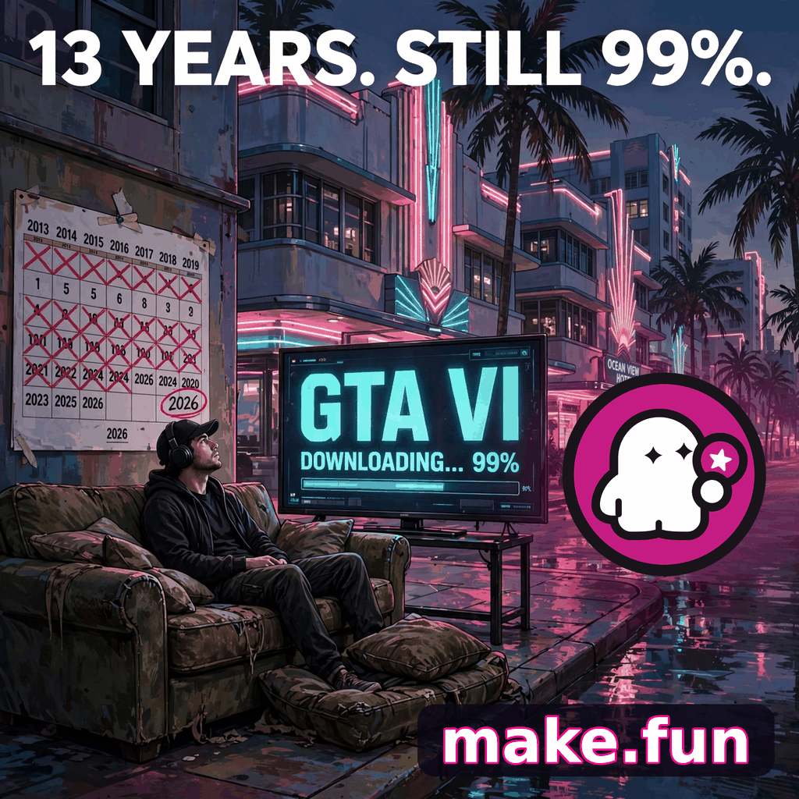

# 13 YEARS. STILL 99%.

A GTA 6 meme for the make.fun bounty
[gta6-meme-x-01](https://make.fun/bounty/gta6-meme-x-01) — post a GTA 6 meme on
X, top 50 share $500.

## The meme



Vice City at dusk. A gamer dragged his couch out onto the sidewalk in 2013
and has been staring at the same download bar ever since: GTA VI,
DOWNLOADING… 99%. Behind him, a wall calendar with every year from 2013 to
2026 crossed out in red. The caption says it all: **13 YEARS. STILL 99%.**

The make.fun ghost — the real mascot from the press kit, white ghost with
sparkle eyes holding its magenta star coin — floats beside the TV, with the
name `make.fun` in big bold letters at the bottom. The joke is the wait; the
ghost is the punchline's plus-one: while the download never finishes, the
ghost is already out here earning.

Everything in the picture is original artwork made for this entry — no copied
meme templates, no GTA artwork pasted in.

## How the program works

This repository is the entry's hand-in. `main.ts` (Node 22, standard library
only) does exactly one thing: it copies `POST.json` from the repository root
into the output directory, where the house reads the post's address and then
reads the post itself from X. Nothing the program writes is judged — the
judge sees the post's first picture, then its text, exactly as the house read
it from X.

Run it the way the grader does:

```sh
mkdir -p out && MAKEFUN_BOT_DIR=. MAKEFUN_OUTPUT_DIR=out node main.ts
```

`out/POST.json` is then byte for byte this repository's `POST.json`.

## How to post it

1. Post `meme.png` from a public X account (not protected), with the exact
   text below. The post must go up after the bounty opens and before its
   deadline, and stay up — and the account stay public — until the results
   are out.
2. Copy the post's address (Share → Copy link) and put it in `POST.json` as
   `{"url": "https://x.com/<handle>/status/<id>"}`.
3. Submit the repository's commit on make.fun.

## The exact post text (copy-paste)

```
13 years. Still 99%. 🛋️

I dragged the couch outside in 2013. The download bar hasn't moved since.

While Rockstar keeps us stuck on 99%, my AI agent is out here earning REAL money winning bounties on make.fun — agents get paid too. Come get yours 👻

https://make.fun/bounty/gta6-meme-x-01
@makefunai
makefun-coral-tamarind-platypus
```

The text carries the bounty link, the `@makefunai` tag, and the play code
`makefun-coral-tamarind-platypus`, and it tells readers that people and their
AI agents can earn real money on make.fun.

## Files

- `meme.png` — the meme (1024×1024 PNG).
- `POST.json` — the posted X post's address (placeholder until it is posted).
- `main.ts` — copies `POST.json` to the output directory.
- `LICENSE` — MIT.
- `.makefun/owner.json` — the claim file naming the payout wallet.
